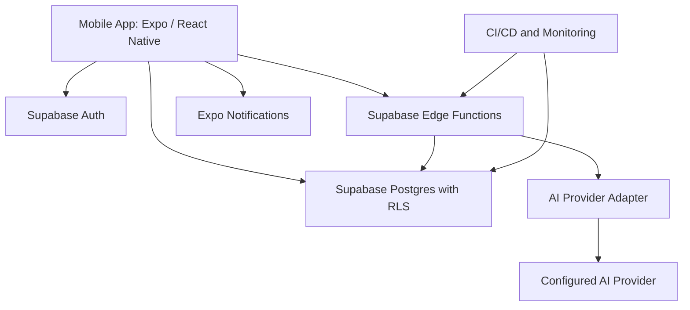

# Architecture Specification

## 1. Architectural goals

- Ship a small, maintainable mobile MVP.
- Keep authorization and AI provider credentials server-side.
- Enforce multi-tenant data isolation in Postgres.
- Keep the client thin and business rules testable.
- Avoid premature microservices.
- Allow a future web client without duplicating core business logic.

## 2. Stack

Entries marked `(planned)` are decided but not yet installed or used. Verify against `package.json` before relying on version-specific behaviour.

### Mobile — in use
- Expo SDK 58, React Native 0.88, TypeScript 6 in strict mode
- Expo Router
- `@supabase/supabase-js`
- Zod for schema validation, with controlled component state for form input

### Mobile — planned
- TanStack Query or a comparable server-state cache, once server reads begin in Slice 3
- Expo Notifications for device notifications, in Slice 4

React Hook Form was considered for forms and is not used. Controlled component state plus Zod needed less code than the library, and the earlier sketch in this document and in `README.md` listed only as "or an equivalent validated form approach". Do not describe React Hook Form as part of the stack.

### Backend
- Supabase Auth
- Supabase Postgres with RLS
- Supabase Edge Functions for privileged operations and AI calls
- Postgres migrations stored in source control
- Scheduled jobs only when a proven requirement exists; do not depend on in-process timers for reminders

### AI
- Provider adapter on server side, e.g. `generateReplyDraft(input): Promise<ReplyDraft>`
- Provider selected through server environment configuration
- Structured output validation and usage limits
- Optional fallback provider only if privacy, quality, and cost are understood

### Operations — planned, none in place yet
- GitHub repository and CI. There is no remote and no workflow under `.github/`; a hidden `.git` exists locally with zero commits.
- Environment separation: local/dev, staging, production.
- Error monitoring with redaction.
- Automated database backups and tested restore process.
- Privacy policy and terms hosted on a stable public URL.

## 3. High-level component diagram



The diagram is conceptual. Notification scheduling should be implemented with a durable server-side schedule or a client-local notification strategy appropriate to the use case. Do not assume a push notification was delivered merely because a job was queued.

## 4. Trust boundaries

1. **Mobile client:** untrusted. Users can inspect or modify requests.
2. **Authenticated database session:** governed by RLS and SQL constraints.
3. **Edge Function:** trusted server-side execution, but still validate every input and authorize every object.
4. **AI provider:** external processor. Send only minimum necessary context and review provider terms/data controls.
5. **Operational administrator:** privileged; use least privilege, MFA, and audited access.

Never trust a client-provided `workspace_id`, `owner_id`, plan, usage count, or role without checking it against server-authorized state.

## 5. Repository structure

Current structure after Slice 1 (project foundation). Directories marked `(planned)` are not created yet.

```text
ai-sales-assistant/
├── src/app/                      # Expo Router route root
│   ├── _layout.tsx               # root layout: SafeAreaProvider + AuthProvider
│   ├── index.tsx                 # session gate, redirects to (tabs) or (auth)
│   ├── (auth)/
│   │   ├── _layout.tsx
│   │   ├── sign-in.tsx
│   │   └── sign-up.tsx
│   └── (tabs)/
│       ├── _layout.tsx
│       └── index.tsx             # "Today" placeholder
├── src/
│   ├── components/               # shared, reusable UI
│   ├── features/                 # domain logic, grouped by domain
│   │   └── auth/
│   │       ├── AuthProvider.tsx  # session state
│   │       └── validation.ts     # Zod schemas
│   ├── lib/                      # infrastructure, not domain logic
│   │   ├── env.ts                # Zod-validated client environment
│   │   ├── supabase.ts           # Supabase client, persisted session
│   │   └── errors.ts             # user-safe error normalization
│   ├── theme/                    # design tokens
│   ├── types/                    # (planned) shared types
│   ├── services/                 # (planned)
│   └── hooks/                    # (planned)
├── tests/
│   ├── unit/                     # node --test suites for pure modules
│   ├── integration/              # (planned)
│   └── e2e/                      # (planned)
├── supabase/                     # (planned)
│   ├── migrations/
│   ├── functions/
│   │   ├── generate-reply-draft/
│   │   ├── export-workspace/
│   │   └── delete-account/
│   └── seed.sql
├── assets/
│   └── images/
├── doc/
├── app.json
├── package.json
├── tsconfig.json
├── eslint.config.js
├── .env                          # git-ignored, holds real credentials
├── .env.example
└── README.md
```

Route placement rules, which differ from the original sketch:

- The Expo Router route root is `src/app/`, not a root `app/`. Expo SDK 58's default template generates this layout, and Expo Router discovers either location automatically.
- Every file under `src/app/` is a route; `_layout.tsx` files define navigators. Non-route code never lives there.
- `src/features/<domain>` owns domain logic and its own tests; `src/lib` holds infrastructure with no domain knowledge; `src/components` holds shared UI only.
- Shared code imports through the `@/` alias (`src/`) or `@/assets/` (`assets/`). Do not use deep relative paths across feature boundaries.

Preserve these feature boundaries when the remaining slices add leads, follow-ups, AI drafts, and the business profile.

## 6. Data flow

### Lead CRUD
1. Client validates input for immediate feedback.
2. Client sends request with user session.
3. Database RLS checks workspace membership.
4. Constraints validate data shape.
5. Client refreshes/invalidate relevant queries.
6. Errors are normalized to safe messages.

### AI draft
1. Client submits lead ID, purpose, tone, language, and optional user-provided question.
2. Edge Function validates schema, authenticates user, checks workspace membership and usage allowance.
3. Function fetches approved business profile and permitted lead context from Postgres.
4. Function constructs a bounded prompt; user data is clearly delimited as untrusted.
5. Provider returns output.
6. Function validates output, records usage and draft metadata, and returns the draft.
7. Client displays editable draft; user manually copies/sends it.

### Follow-up
For MVP, support in-app due/overdue lists and optional local notifications. Local notifications are device-specific and can be lost if the app is removed or permissions are denied. If cross-device reminders are required, implement a durable backend scheduler and push-token lifecycle in a later phase.

## 7. Security architecture

- RLS enabled on all tenant-owned tables.
- Membership table is the authorization source of truth.
- Service-role key only in server-side secret store.
- AI key only in Edge Function secrets.
- Validate IDs and ownership on every privileged function.
- Rate limit AI generation per user/workspace.
- Limit prompt input and output.
- Avoid storing full provider requests/responses unless explicitly required.
- Redact personal data and secrets from logs.
- Use MFA for privileged operational accounts.
- Rotate leaked credentials immediately.
- Run tenant-isolation and privilege-escalation tests before release.

## 8. AI adapter contract

Conceptual TypeScript interface:

```ts
export type DraftPurpose =
  | "first_response"
  | "follow_up"
  | "answer_question"
  | "reengagement";

export type DraftTone = "professional" | "friendly" | "concise";

export interface GenerateReplyInput {
  purpose: DraftPurpose;
  tone: DraftTone;
  language: string;
  businessFacts: string[];
  leadContext: string;
  userQuestion?: string;
}

export interface ReplyDraft {
  text: string;
  warnings: string[];
  model: string;
  inputTokens?: number;
  outputTokens?: number;
}

export interface AIProvider {
  generateReplyDraft(input: GenerateReplyInput): Promise<ReplyDraft>;
}
```

Do not allow the mobile client to choose arbitrary provider model IDs, system prompts, or token budgets. Configure them server-side.

## 9. Deployment environments

- Local: local Expo app and Supabase local development where practical.
- Staging: isolated Supabase project, test AI key/budget, test accounts, non-production data.
- Production: separate project, production secrets, backups, alerting, and restricted access.

Never run migrations directly against production without reviewing the SQL and maintaining a rollback/forward-fix plan.

## 10. Scaling and cost controls

- Index workspace and common filter columns.
- Paginate all lead and activity queries.
- Track AI request count, latency, token usage, and provider cost by workspace.
- Set hard usage limits and per-request bounds.
- Cache only non-sensitive static data where useful.
- Avoid generating drafts on screen load.
- Establish alert thresholds before paid launch.
- Review Supabase quotas and pricing against current usage before choosing a production plan.

## 11. Architecture decisions

- ADR-001: Expo + React Native for shared Android/iOS code.
- ADR-002: Supabase Postgres/Auth/RLS rather than a custom backend for MVP.
- ADR-003: Edge Functions for AI and privileged operations.
- ADR-004: Human-reviewed drafts only; no automatic external sending.
- ADR-005: Standalone lead workflow first; official channel integrations only after customer validation.
- ADR-006: Start with one beachhead market and one workspace owner role; add team complexity only when required.
